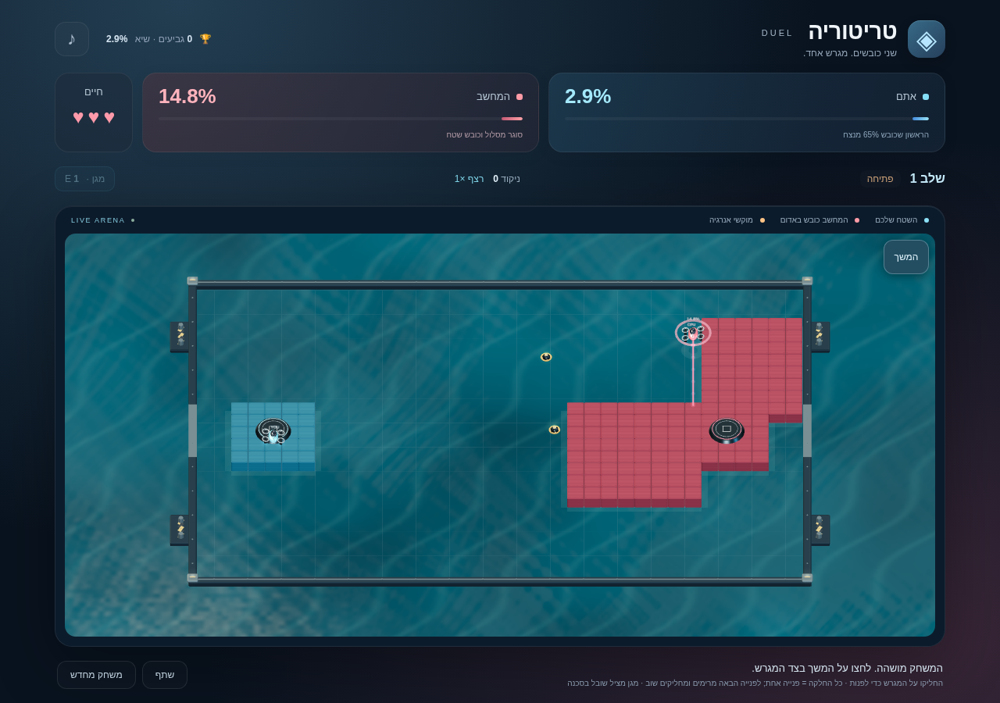

# טריטוריה DUEL · Territory

משחק כיבוש שטחים בהשראת Xonix, עם תחרות מול שחקן מחשב שבונה מסלולים וכובש שטח בעצמו. פותח עם Phaser, Three.js, TypeScript ו־Vite.



## לשחק ללא התקנה

1. ב־GitHub לחצו **Code → Download ZIP**.
2. חלצו את ההורדה באמצעות **חלץ הכול**, לתיקייה חדשה.
3. לחצו פעמיים על **play.html** (או **play**, אם סיומת הקובץ מוסתרת).
4. המשחק נפתח בדפדפן. לחצו **מתחילים לשחק**.

אין צורך בשרת, ב־Node.js או ברשת כדי לשחק. לעדכון הורידו וחלצו שוב. כדי לשמור את הגביעים באותו דפדפן, החליפו את `play.html` בתיקייה שבה שיחקתם עד עכשיו ופתחו אותו מאותו מקום. אם הקובץ נפתח בתוכנה אחרת, השתמשו ב־**פתח באמצעות → Google Chrome / Microsoft Edge**.

## העלאה לאתרי משחקים

הבנייה יוצרת גם `releases/territory-duel-web.zip`, עם `index.html` עצמאי בשורש. [הוראות העלאה ותיאורים מוכנים](docs/portal-submission.md) כוללים מסלול העלאה ל־itch.io והבחנה בין תשלום מרצון להכנסה מרשת פרסום. אין בחבילה SDK של פרסומות או חשבון רשת מחובר.

## קידום והשקה

[ערכת הקידום המוכנה](docs/launch-kit.md) כוללת הודעות שיתוף, תסריטי סרטונים וניסוי של שבוע. [כרטיס הסטורי](https://asifeyal-gif.github.io/territory-game/promotion.html) מאפשר הורדת תמונה מוכנה בגודל 1080×1920. טבלת המשוב נמצאת ב־`docs/launch-feedback.csv`.

## שיתוף, שיאים ואתגר יומי

- לחיצה על הגביעים בראש המסך פותחת את השיאים: ניקוד, השלב הגבוה ביותר, גביעים וניצחונות. פתיחת המסך משהה את הסיבוב; סגירתו מחזירה את מצב ההשהיה הקודם.
- אתגר יומי מתחלף לפי תאריך ישראל וזהה לכל השחקנים. לאחר השלמתו אפשר לאסוף גביע אחד במסך השיאים. אי אפשר לאסוף שוב באותו יום, גם אחרי רענון.
- כפתור **שתף** פותח שיתוף מובנה בדפדפנים התומכים בו, או מעתיק קישור במחשב. נשלחים הקישור הציבורי והניקוד, רק בעקבות לחיצה.
- הרשומות מקומיות לדפדפן בלבד. אין שירות מדידה מרוחק, חשבון משתמש, דירוג עולמי, פרסומות או סליקה. נתוני כל השחקנים אינם נשלחים לבעל המשחק.
- העמוד הראשי ב־GitHub Pages מפנה למשחק העצמאי; מידע לתצוגת קישור ברשתות חברתיות כלול ב־HTML.

## שלבים, גביעים ואתגר

- כל ניצחון מעניק **גביע אחד** ופותח את השלב הבא. לחצו **לשלב הבא** במסך הניצחון.
- היעד מתחיל ב־65%, עולה בשני אחוזים בכל שלב ומוגבל ל־75%. המחשב חייב להגיע לאותו יעד.
- בכל שלב היריב מהיר יותר. משלב 3 מתחילים עם שלושה מוקשים, ומשלב 5 עם ארבעה. גם בתוך סיבוב הלחץ עולה עם הכיבוש.
- המחשב יכול להפסיק לכבוש ולרדוף אחרי שובל פתוח. לפני תחילת התקפה יש התרעה; הוא נע משבצת־משבצת, ללא טלפורט או סיבוב מיידי לאחור.
- **מגן (E או הכפתור)** מגן מפגיעות ומחיתוך שובל במשך שלוש שניות. הוא אינו מגן מגבולות או מחציית השובל של עצמכם. מתחילים עם טעינה אחת, אפשר להחזיק עד שתיים.
- כל שלושה כיבושים של לפחות שש משבצות מחזירים טעינת מגן. חיתוך שובל המחשב מעניק טעינה ו־200 נקודות.
- כיבוש מעניק עשר נקודות למשבצת, כפול רצף הכיבושים (עד ×5). פסילה שוברת את הרצף.
- הניקוד מצטבר בין שלבים. בהפסד אפשר לנסות את אותו שלב מחדש עם הניקוד שהיה בתחילתו. **משחק מחדש** חוזר לשלב הראשון ומאפס את ניקוד המסע.
- הגביעים נשמרים מקומית בדפדפן ואינם נמחקים בהפסד או בהתחלת מסע חדש. בלי אחסון מקומי זמין הם נשמרים רק במשך ההפעלה הנוכחית.

## חוקי התחרות

- **אתם בכחול, המחשב באדום.** הראשון שמחזיק ביעד הכיבוש של השלב (**65% בשלב הראשון**) מנצח.
- השחקן נע אוטומטית. חצים או WASD משנים כיוון בגבול המשבצת; אין סיבוב מיידי לאחור. בטלפון מחליקים אצבע על המגרש: הכיוון משתנה בזמן התנועה, בלי להמתין להרמת האצבע. כל החלקה קצרה יוצרת פנייה אחת; לפנייה הבאה מרימים את האצבע ומחליקים שוב. תנועות קטנות ואלכסוניות אינן יוצרות פניות נוספות. לחיצה על **הצג חצים** מפעילה כפתורי כיוון לפי העדפה. מחווה מבוטלת כשמפסיקים משחק, מחליפים לשונית או כשהמגע נקטע. במסך טלפון עומד הזירה מוצגת לאורך והחלקות תמיד מתאימות לכיוון שעל המסך.
- צאו מהכחול, השאירו שובל וחזרו לכחול. השובל והאזורים שסגרתם שאין בהם מוקש אנרגיה או אזור מוגן של היריב מתווספים לשטח שלכם.
- המחשב פועל באותה צורה: מתכנן מסלול, יוצא מהאדום, משאיר שובל וחוזר לאדום. הוא מעריך את תנועת המוקשים ומעדיף מסלולים בטוחים.
- אפשר **לגנוב שטח זה מזה** באמצעות סגירת מסלול. הבסיס ההתחלתי הקטן של כל צד נשאר מוגן ואי אפשר לכבוש אותו.
- **חתכו שובל אדום** כדי לשלוח את המחשב לבסיס ולמחוק את המסלול הפתוח שלו. הוא מתאושש במשך 1.2 שניות. הוא יכול לחתוך את השובל הכחול שלכם באותו אופן.
- מוקשי האנרגיה הזהובים נעים בשטח הניטרלי ומוחזרים משטחי שני הצדדים. הם יכולים לפגוע בשובלים של שניכם.
- יציאה מהמגרש, חציית השובל של עצמכם, פגיעה במוקש או חיתוך השובל שלכם עולים בלב. חוזרים לבסיס, השובל נמחק, והמשחק ממתין שנייה לפני החידוש. שטח שכבר נכבש נשמר, אלא אם המחשב כובש אותו מחדש.
- יש שלושה לבבות בכל שלב. הפסילה השלישית מסיימת את הניסיון הנוכחי. אפשר גם להפסיד כשהמחשב מגיע ליעד השלב, אפילו אם נשארו לבבות.
- בהתנגשות בין הדמויות, השטח של כל צד מגן עליו. התנגשות בשטח ניטרלי מחזירה את שניהם לבסיס ולשחקן יורד לב.
- כפתור ההשהיה הקבוע בצד המגרש או רווח משהים וממשיכים, ללא חלון שמכסה את המשחק. שינוי מיקוד בזמן החלקה אינו משהה. הסתרת הלשונית או יציאה מהדפדפן מקפיאות את **כל** התנועה, התכנון וזמני ההתאוששות.
- **משחק מחדש** חוזר לשלב הראשון ומאפס את כל הסיבוב, כולל שטחי המחשב, המסלול המתוכנן וההתאוששות. השיא האישי נשמר בדפדפן כאשר האחסון המקומי זמין.
- כפתור ♪ מפעיל צלילים. הם כבויים כברירת מחדל.

## מראה ותפעול

זירה תלת־ממדית בסגנון מתקן ימי: מים עם גלים, הבזקי אור והשתקפות שמיים, מסגרת מתכת עם מחברים ורציפי עגינה, תאורת שמש וצללים רכים. המצלמה קבועה כדי לשמור על כיווני שליטה ברורים. שטחים בכחול ובאדום צומחים לאיים מוגבהים; רחפנים עם גוף מתכתי, זכוכית, מדחפים מסתובבים, פנסים ותוויות צד נעים מעליהם. לוחות השטח כוללים קצוות מעוגלים, ברגים וטקסטורת מתכת. שובלי אור וגלי כיבוש מסמנים את הפעולות. אם WebGL אינו זמין, המשחק מציג אוטומטית זירה דו־ממדית תואמת. הרשת עדינה ומשמשת לכיוון התנועה. צבעים, תוויות ופסי התקדמות מפרידים בין הצדדים ובין מוקשי האנרגיה. המגרש כולו נשאר נראה במסכים שונים. גובה המשחק בטלפון קבוע לפי שטח המסך הקטן הזמין, כדי שסגירה ופתיחה של סרגל Safari לא תזיז את הזירה. גלילה וגרירת הדף חסומות בשטח המשחק. אין נכסים חיצוניים, פונטים מרוחקים או שעון משחק. האיכות מותאמת אוטומטית לעומס; ברינדור תוכנה הרזולוציה מופחתת והצללים כבויים. הכפתור להתחלת משחק זמין אחרי הכנת הזירה, כדי לצמצם עצירות בפתיחה.

## פיתוח

Node.js **24 ומעלה** ו־npm.

```sh
npm ci
npm run dev -- --port 5173 --strictPort
```

במחשב מקומי פתחו `http://localhost:5173` והשאירו את המסוף פתוח. השרת תומך ברענון אוטומטי.

```sh
npm test
npm run build
npm run preview -- --port 4173 --strictPort
```

הבנייה בודקת TypeScript, יוצרת אתר סטטי ב־`dist/` ומעדכנת את `play.html` העצמאי בשורש המאגר. יש לשמור ל־GitHub גם את `play.html` המעודכן. אפשר לפרסם את `dist/` אצל ספק אחסון סטטי. שרת preview מיועד לבדיקה מקומית.

## בדיקות דפדפן

```sh
npx playwright install chromium
npm run test:browser
```

אם Chromium מותקן ב־`/usr/bin/chromium`, הבדיקה משתמשת בו. אפשר לציין נתיב אחר דרך `CHROMIUM_PATH`. הבדיקה מפעילה שרת זמני בפורט 5174 ובודקת תנועה, כיבוש של שני הצדדים, חיתוך שובל המחשב, השהיה, פסילות, ניצחון, איפוס ומסכים שונים. צילומים נשמרים ב־`test-results/`. חלק מהמצבים מקודמים באופן דטרמיניסטי, ונראות הלשונית מדומה בבדיקת ההשהיה.

ה־HTML העצמאי נבדק אחרי בנייה, ללא בקשות רשת. בסביבת ענן שחוסמת כתובות file://, הבדיקה מריצה את אותו HTML באופן מוטמע; פתיחה ישירה של קובץ במחשב המשתמש נותרת בדיקה ידנית.

## מבנה

- `src/engine.ts` — חוקים, אירועי תנועה לפי סדר זמן, יריב מתכנן מסלולים וכיבוש באמצעות flood fill.
- `src/main.ts` — מחזור המשחק ב־Phaser, ממשק, שליטה ושמע, וציור דו־ממדי חלופי.
- `src/arena3d.ts` — זירת Three.js, רחפנים, תאורה, צללים והתאמת איכות.
- `src/materials.ts` — טקסטורות מתכת מקומיות, שובלי אור וציור המים.
- `src/style.css` — עיצוב והתאמה למסכים.
- `tests/engine.test.ts` — בדיקות חוקים, תחרות מלאה, העברת בעלות, התנגשויות ותכנון מחשב.
- `tests/browser.mjs` — בדיקות Chromium, כולל החלקות מגע דרך ממשק הדפדפן, ביטול מחווה והפעלת כפתורים חלופיים.
- `scripts/portable.mjs` — אריזת הגרסה העצמאית.

רוחב המגרש 36 משבצות, והמהירות 3.6 משבצות בשנייה: כעשר שניות לרוחב המלא. המחשב מעט איטי יותר. תכנון המחשב והחוקים מופרדים מהציור, והתנהגותם אינה תלויה בקצב רענון הדפדפן. חבילות Phaser ו־Three.js גדולות יחסית ולכן Vite מציג אזהרת גודל; הקובץ העצמאי כולל את החבילה בכוונה.
